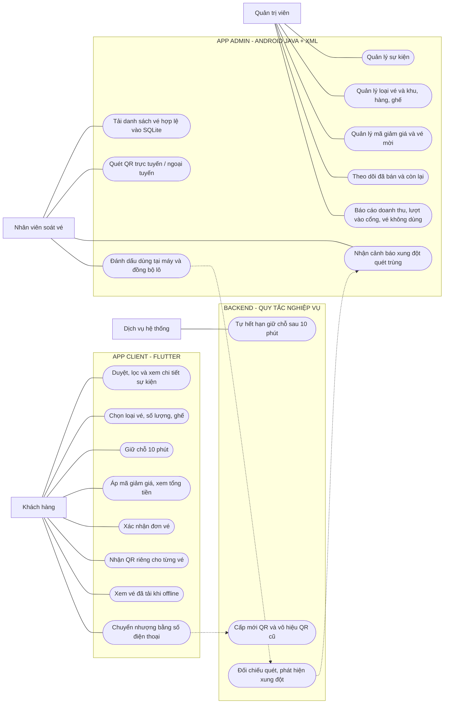
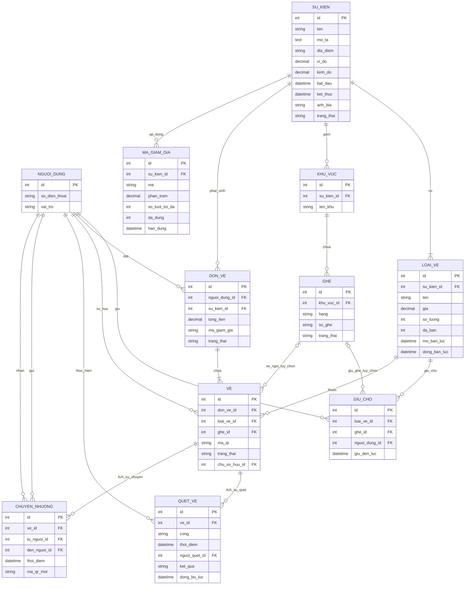

# Đề 24 – Hệ thống bán vé sự kiện và kiểm soát cổng

## 1. Sơ đồ Use Case

## 2. Sơ đồ cơ sở dữ liệu (ERD)

## 3. Bảng phân công

| Thành viên  | Phụ trách chính | Công việc cụ thể | Sản phẩm bàn giao |
|---|---|---|---|
| Trần Tuấn Tú - 241A010591 – Backend & CSDL | Thiết kế hệ thống, nghiệp vụ vé | Thiết kế CSDL và quan hệ; API sự kiện, giữ chỗ 10 phút, đơn vé; giao dịch chống bán quá số lượng, khóa ghế; mã giảm giá, chuyển nhượng và đổi QR; tạo dữ liệu mẫu | ERD, SQL migration/seed, API tài liệu và kiểm thử giao dịch |
| Nguyễn Thanh Tiến - 231A010705 – App Admin (quản trị) | Android Java + XML – quản lý | CRUD sự kiện, loại vé, sơ đồ khu/hàng/ghế, mã giảm giá và vé mời; dashboard đã bán/còn; báo cáo doanh thu và lượt vào cổng theo giờ, vé không dùng | Mã nguồn Admin, màn hình quản trị, báo cáo và demo |
| Đỗ Nhật Long - 241A010052 – Soát vé & đồng bộ | Android Java + XML – chế độ cổng, kết hợp Backend | Quét QR online/offline; tải trước danh sách vào SQLite; đánh dấu vé đã dùng và lưu log cục bộ; đồng bộ theo lô; phối hợp TV1 triển khai kiểm tra quét trùng hai cổng và trả thông báo xung đột | Module scanner, SQLite, API đồng bộ, kịch bản kiểm thử 2 cổng mất mạng |
| Lê Thiên Nga - 253A010012 – App Client (Flutter) | Giao diện người mua | Duyệt, lọc, xem chi tiết sự kiện; chọn loại vé, số lượng và ghế; đồng hồ giữ chỗ 10 phút; mã giảm giá/tổng tiền; đơn vé, QR riêng từng vé và lưu offline; chuyển nhượng qua số điện thoại | Mã nguồn Flutter, các luồng mua vé, lưu vé offline và demo |

## 4. Ghi chú kỹ thuật quan trọng

### Quy tắc triển khai phải kiểm thử

1. **Giữ chỗ 10 phút:** máy chủ xác định thời điểm hết hạn, không dùng bộ đếm phía Flutter làm nguồn sự thật. Giao dịch tạo đơn phải kiểm tra giữ chỗ còn hạn và khóa tồn kho/ghế để không bán trùng.
2. **QR một lần:** kiểm tra trạng thái vé bằng giao dịch nguyên tử phía máy chủ. `quet_ve.ket_qua` giữ các giá trị gốc `HOP_LE`, `DA_DUNG`, `SAI_SU_KIEN`.
3. **Quét ngoại tuyến:** mỗi máy Admin tải vé hợp lệ xuống **SQLite**, lưu log quét và đánh dấu đã dùng cục bộ. Khi có mạng, gửi lô có mã định danh riêng từng lần quét để thao tác đồng bộ có thể thử lại mà không ghi trùng.
4. **Hai cổng cùng offline:** không thể bảo đảm ngăn chặn tuyệt đối việc dùng trùng ngay tại thời điểm quét nếu hai máy không trao đổi dữ liệu. Máy chủ ghi nhận lượt hợp lệ đầu tiên theo quy tắc thống nhất và trả về mã lỗi nghiệp vụ **XUNG_DOT_QUET_TRUNG** cho lượt còn lại khi đồng bộ; không tự ý thêm giá trị này vào enum `quet_ve.ket_qua` của đề gốc.
5. **Chuyển nhượng:** QR cũ phải vô hiệu sau khi cấp QR mới trên server. Danh sách offline được tải trước có thể cũ nên phải cảnh báo, và xử lý xung đột khi đồng bộ.
6. **Điểm thiếu trong cấu trúc gốc:** các bảng có `nguoi_dung_id` nhưng đề chưa liệt kê bảng `nguoi_dung`, vì vậy ERD bổ sung **bảng phụ trợ tối thiểu** này. API lọc `chuDe` cũng cần có cột hoặc quan hệ chủ đề tương ứng; không tự sửa cấu trúc bảng `su_kien` được giao trước khi nhóm thống nhất.
7. **Dữ liệu mẫu:** tối thiểu **10 sự kiện × 4 loại vé**, trong đó **1 sự kiện có 300 ghế**, tổng **500 vé bán**, **350 lượt quét**. Có thể dùng loại vé thứ tư như Early Bird (bên cạnh Thường, VIP, Sinh viên), còn vé mời quản lý theo nghiệp vụ riêng.

